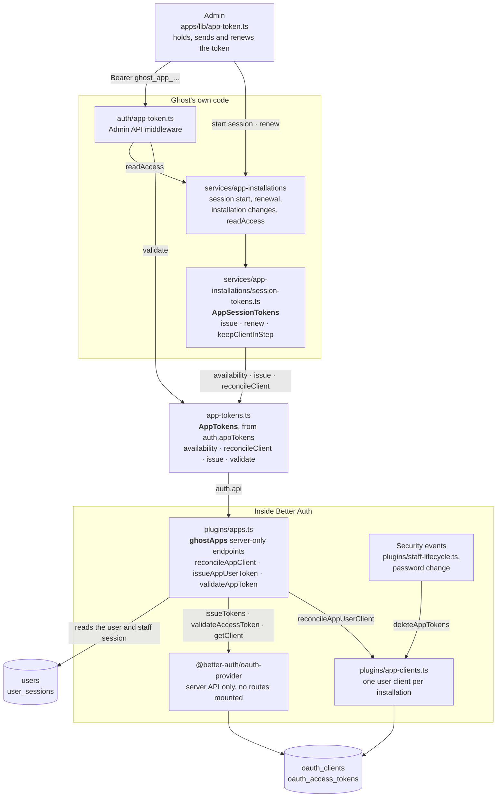
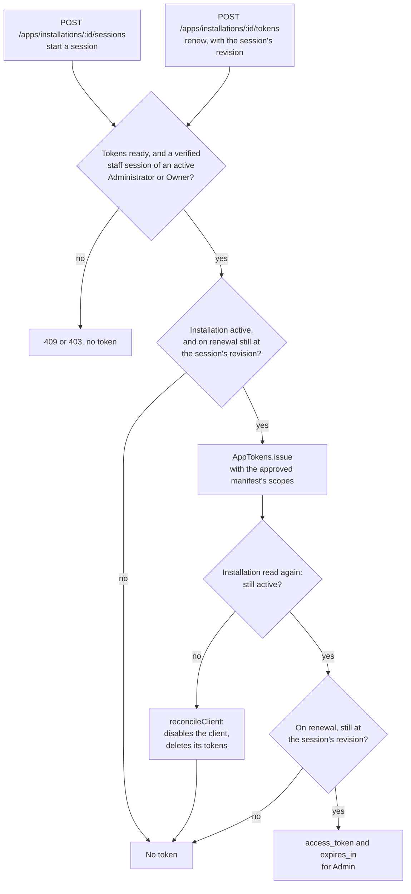
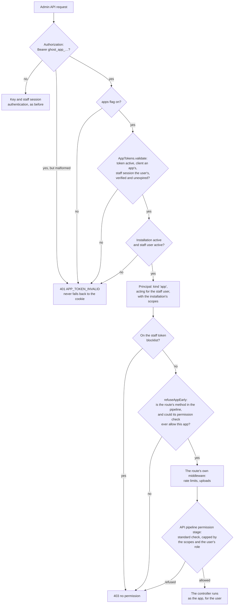

# Better Auth

Staff authentication on [Better Auth](https://www.better-auth.com), behind the
`auth:engine` config key. See the
[migration plan](../../../../../docs/plans/better-auth-migration.md)
for the design.

## Engine

`auth:engine` is `legacy` (default) or `better-auth`. Under `legacy` boot never
loads Better Auth, but its tables are there and the legacy engine keeps
passwords in `user_accounts` (see [Passwords](#passwords)). Under
`better-auth` boot builds the instance after settings.

Better Auth needs MySQL. On SQLite the config schema
([`shared/config/schema.ts`](../../../shared/config/schema.ts)) turns
`better-auth` into `legacy` with a warning, so everything that reads
`auth:engine` sees the engine in use. SQLite installs stay on legacy until 7.0
drops SQLite.

Under `better-auth` the Admin API serves the handler on `/auth/*`
(`web/api/endpoints/admin/better-auth.ts`), after the private cache header and ahead of the API's body
parsers. Better Auth's Node handler reads bodies with no size limit, so the
router reads them first, capped at 64 KB, and Better Auth takes the result
from `req.body`. Better Auth's limiter runs on Ghost's
`spam` limiters through `customStorage`, in every environment: each native
credential route counts against its compatibility route's limiters, sharing
their counters, and a successful sign-in or password reset clears `userLogin`
as the compatibility routes do. `/change-password` and `/verify-password`,
which check the current password, count against `globalBlock` under their own
paths. Other paths are not limited. An after-hook strips
session tokens from native response bodies, by shape: a top-level `token`,
`session.token`, and each list item's `token`. The token still travels in the
`httpOnly` session cookie, and server-side `auth.api` calls keep it. Origin
and CSRF checks are pinned on, since Better Auth turns them off when
`NODE_ENV` is `test` or `TEST` is set. Admin config publishes `auth: {engine}`.

Under `better-auth`, `auth/authenticate.ts` keeps the `api-key` middleware and
then runs `resolvePrincipal` (`auth/resolve-principal.ts`), which sets
`req.auth` to a `Principal` (`auth/principal.ts`) and derives `req.user` and
`req.api_key` from it. A verified key wins; otherwise the cookie branch reads
Better Auth's session, pins it to the admin origin and to the session's own
`origin`, and treats an unverified session, or one with no `origin`, as
anonymous. A request that sends an `Authorization` header never falls back to
the cookie. Legacy session cookies are not read. `Bearer` is still rejected
until Phase 4, except app tokens (see [App tokens](#app-tokens)), which are
authenticated ahead of the key check.

- `create-auth.ts`: `createAuth()` builds the instance with Ghost's options
  (plan §3.1) from injected dependencies.
- `rate-limit.ts`: the `customStorage` that maps native credential routes to
  Ghost's limiters.
- `index.ts`: the boot-owned service root, exposed as `auth.betterAuth`. Boot
  calls `init()`; consumers read `.service`. It is the one `defineService` root
  outside `server/services`, so the
  [service checks](../../services/README.md#roots-outside-this-directory) do
  not apply to it.
- `plugins/staff-lifecycle.ts`: `ghostStaffLifecycle`, Ghost's staff status
  rules (plan §3.3). `/sign-in/email` keeps Better Auth's
  `INVALID_EMAIL_OR_PASSWORD` for an unknown email, a wrong password and a
  wrong password on a suspended account, so it can't enumerate staff (unlike
  legacy sign-in, SC-90). A `session.create.before` hook refuses non-active
  users on every path, so a matching password on a `locked` account is
  `PASSWORD_RESET_REQUIRED` and on an `inactive` one `ACCOUNT_SUSPENDED`;
  magic-link, passkey and SSO sign-in instead set a `locked` user `active`.
  Any failed password sign-in for a `locked` user emails the legacy reset
  link, as legacy sign-in does, without awaiting it or changing the response.
  The after-hook that does this runs after the endpoint's CSRF check, so a
  cross-origin request sends nothing. Every new session sets `last_seen` and
  moves a `warn-*` status to `active`; a lock or suspension committed after
  the guard's read stands, and a failure is logged without failing sign-in.
  The guard reads the status without a lock, so a suspension that commits
  while a session is being created can leave a session row, which
  `revokeUserSessions` in the same gap misses. Anything that trusts a session
  or token (the Admin API resolver, revocation, app tokens) must check the
  user's status too. For Better Auth's own endpoints, including the
  `/session/verify` compatibility routes, `ghostSessionGate` does (below). A
  successful `/reset-password` sets a `locked` user `active`, as legacy
  `doReset` does; it refuses an `inactive` user's token
  before changing the password, and a suspension that lands during the reset
  stands. Server-only: `createVerifiedSession`, which requires the
  admin origin, `revokeUserSessions` and `revokeAllSessions`.
- `cleanup.ts`: the daily `clear-expired-auth-rows` job (plan §4.6), which
  deletes expired `user_sessions` and `verifications` rows. Better Auth checks
  expiry on read but never deletes them. It runs under either engine, since
  sessions outlive a rollback, and deletes in batches by primary key, as the
  `rate_limits` cleanup does, so it doesn't deadlock with live writes.
- `plugins/sso.ts` (`ghostSso`): server-only `createSsoSession`, for the SSO
  adapter hook described below. It applies the passwordless rules above
  (unlocks `locked`, refuses `inactive`) and creates a verified session pinned
  to the admin origin. Team SSO is `@better-auth/sso` (Phase 8).
- `plugins/session-gate.ts`: `ghostSessionGate`, registered first, decides
  from one session lookup per request whether the session cookie reaches the
  endpoint. A session whose user is not active (one that outlived a
  suspension, above) is deleted; an unverified one is anonymous outside
  `/device-verification/*` and `/sign-out` (see
  [Device verification](#device-verification)). Either way the endpoint runs
  without the cookie, keeping the other cookies as sent, as
  `resolvePrincipal` treats the session. Better Auth's server-side `auth.api`
  calls run it too, so the compatibility routes are covered. `/sign-out`
  skips it: it deletes the session itself.
- `plugins/device-verification.ts`: `ghostDeviceVerification`, email-code
  verification of new devices, described below.
- The plugin emails codes through `auth/emails/sign-in-code.ts`, which the
  legacy session service also uses: the legacy template and subject, and the
  device details, with injectable geolocation.
- `session-controller.ts`: `POST` and `DELETE /session` under `better-auth`,
  described below.
- `staff-sessions.ts`: the security events' session changes, described below.
- `stripe-connect-state.ts`: Stripe Connect's OAuth `state`, which legacy
  keeps on `req.session`. Under `better-auth` it is a `verifications` row with
  the identifier `stripe-connect:<userId>`, expiring after an hour. Starting
  a connection replaces it, a mismatch or a failed save keeps it as legacy
  does, and a successful save deletes it, so a token saves once.
- `routes.ts`: the Better Auth paths that matchers, limiters and
  `disabledPaths` refer to. A mistyped path matches nothing, silently.
- `plugins/apps.ts`: `ghostApps`, and the OAuth provider and `jwt` plugins
  that issue app tokens. `plugins/app-clients.ts` holds the user client's row
  and keeps it in step with its installation. See [App tokens](#app-tokens).
- `app-tokens.ts`: the interface the app installations service and the Admin
  API use for app tokens, over `ghostApps`'s server-only endpoints. It loads
  under either engine and answers whether app tokens are available: `ready`,
  `legacy_engine`, or `needs_restart` while the provider isn't registered.
  Until they're `ready` it issues and validates nothing, and its other writes
  do nothing.

Ghost mounts at the subdirectory, so on a subdirectory install requests reach
Better Auth as `/blog/ghost/api/admin/auth/...`. `basePath` therefore carries
the subdirectory, and `baseURL` is the admin origin only, because Better Auth
ignores `basePath` when `baseURL` has a path.

The session cookie is `ghost-admin-api-session` with the legacy path and
`httpOnly`. When the admin URL is HTTPS, `useSecureCookies` makes it `Secure`
and names it `__Secure-ghost-admin-api-session`, so a browser only accepts it
over HTTPS, and `sameSite` is `none`; otherwise it is `lax`. Unlike the legacy
cookie this follows the admin URL rather than the site URL, since the cookie
lives on the admin origin: an HTTPS site with an HTTP admin URL still gets a
cookie the browser accepts. It is not `__Host-`, which would need `Path=/` and
send the admin session with every frontend request. Its `maxAge` is Better
Auth's, in seconds, from `expiresIn`. The auth frame (`web/admin/app.js`)
accepts either name.

Better Auth reads the client IP, for session rows and its rate limiter, only
from request headers. A client can set any header, so Ghost points
`advanced.ipAddress.ipAddressHeaders` at its own `x-ghost-client-ip`, which
`setClientIPHeader` (`client-ip.ts`) overwrites with Express's `req.ip` as
`trust proxy` resolved it. Mount it before any route that hands request headers
to Better Auth. `ipv6Subnet: 64` and `normalizeIP` in Ghost's `BackoffLimiter`
format an address the same way, so both count a client against the same key.
IPv6 counts per /64, the block a single subscriber usually holds.

- `knex-adapter.ts`: a Better Auth database adapter over a Knex instance. It
  imports nothing from Ghost, so it can become a package later. Ghost
  migrations own the DDL, so there is no `createSchema`. It generates no ids:
  it needs `advanced.database.generateId`, and Ghost passes `generateGhostId`
  (ObjectIds) from `ghost-models.ts`.
- `ghost-models.ts`: maps Better Auth's `user`, `session`, `account` and
  `verification` models onto `users`, `user_sessions`, `user_accounts` and
  `verifications`, plus the `users` gaps described below.
- `credential-password.ts`: the legacy engine's password store. See
  [Passwords](#passwords).

## Passwords

Both engines hash with bcrypt and read and write the same `credential` row in
`user_accounts` (plan §4.5), so a password changed through one engine works in
the other. There is no dual write: `users.password` holds the `!` placeholder
once the row has the hash. The 6.79 migrations that created the tables copied
every user's hash into a row and left `users.password` as it was, so users
whose password hasn't changed since still carry their old hash there, unread.

- The `User` model hashes in `onSaving`, then `onSaved` writes the row with
  the save's transaction, inserting it for a new user. `add`, `changePassword`
  and `edit` with a password open a transaction when the caller has none.
  Setup, invitations, imports, resets and `lock()` all save through the model.
- Sign-in, `changePassword`'s current-password check and reset tokens
  (`auth/passwordreset.ts`) read the hash from the row. A reset token is signed
  with the hash, so a password change through either engine invalidates it.
- A user without a credential row has no password.

> [!WARNING]
> The credential row is the only copy of a user's current password. A release
> from before 6.79 reads `users.password` instead, so rolling back to one
> without rolling the migrations back locks out or reverts anyone whose
> password changed since. Plan §8 has the recovery.

## App tokens

Apps open only under `better-auth`, and under any other engine Ghost refuses
to preview, install or approve one (`409 APP_AUTH_ENGINE_UNSUPPORTED`); listing
and uninstalling still work. When an app session starts, Ghost issues the
staff user an app user token for the app from `@better-auth/oauth-provider`,
bound to their staff session, and Admin sends the app's Admin API calls with
it as `Authorization: Bearer` and no cookie.

### How the pieces fit

Ghost's own code reaches app tokens through one interface, `AppTokens`, which
`auth.appTokens` returns. Everything that knows about OAuth clients or the
provider's tables sits behind Ghost's `ghostApps` plugin. The app
installations service issues tokens and keeps clients in step through it. The
Admin API's app token middleware validates tokens through it. Security events
delete a user's app tokens. Admin holds an app session's token and sends the
app's calls with it.



- **Admin** keeps the token outside React state, so renewing it never reloads
  the app's frame.
- **`auth/app-token.ts`** turns a valid token into the request's principal.
  It reads the installation and the user again on every call.
- **`AppSessionTokens`** decides who gets a token, issues one when an app
  session starts or renews, and keeps each installation's client in step
  after every change to it.
- **`AppTokens`** is the only way in. `availability` says whether tokens can
  be used here at all. Until it's `ready`, `issue` throws, `validate` returns
  null and `reconcileClient` does nothing.
- **`ghostApps`** adds three endpoints that can only be called on the server.
  They hold the checks the provider doesn't make, listed below.
- **`app-clients.ts`** maps an installation to its OAuth client and back. It
  keeps the client enabled or disabled to match the installation, and deletes
  tokens.
- **The provider** stores, issues and validates tokens. None of its routes is
  mounted.

### What issuing and validating check

| Check                                                     | `issueAppUserToken` refuses with | `validateAppToken` |
| --------------------------------------------------------- | -------------------------------- | ------------------ |
| The provider knows the token, and it hasn't expired       | n/a                              | null               |
| The client is the installation's user client, and enabled | `client_unavailable`             | null               |
| The user exists                                           | `user_not_found`                 | n/a                |
| The staff session exists and is the user's                | `session_unavailable`            | null               |
| The staff session is verified and hasn't expired          | `session_unavailable`            | null               |

An issued token lasts an hour, or until its staff session ends if that's
sooner. Its scopes are the requested ones the client lists.

### How an app session gets a token

Admin starts an app session when it opens an app's page. While the app runs,
Admin renews the token about ten minutes before it expires, and at once when
a call is refused because the token expired. A renewal names the revision the
session started with. Both issue a new token; nothing about the session is
stored.



Starting a session re-checks the app's manifest and reconciles the client
before it issues. If `issue` is refused because the client is out of step
with an installation that is still active, the client is reconciled from a
fresh read and the token issued once more.

Every change to an installation, such as approval, suspension or uninstall,
reconciles its client once the change commits. A failed reconcile is logged,
not thrown: every call re-checks the installation, so a client out of step
grants nothing, and the next run heals it.

### What happens to a request with an app token

Every call re-checks the token, the staff session, the installation and the
user, so nothing depends on a token having been deleted. The scopes come from
the installation's approved manifest at the time of the call.



The scopes only cap the standard permission check. A method whose check is
its own, or that has none, would see only the staff user. So apps are refused
there unless the method is on the allowlist in
`api/endpoints/utils/permissions.js`, which is empty. A controller outside the
pipeline has no permission stage at all, so apps are refused there too.
`refuseAppEarly` makes those refusals, and the one for a scope the app wasn't
approved for, before the route's own middleware runs. A rate limit or an
upload then never runs for an app request that can't succeed.

### The types

| Type                        | Where                                          | What it is                                                          |
| --------------------------- | ---------------------------------------------- | ------------------------------------------------------------------- |
| `AppTokens`                 | `app-tokens.ts`                                | The interface Ghost's code uses for app tokens                      |
| `AppTokensAvailability`     | `app-tokens.ts`                                | `ready`, `legacy_engine` or `needs_restart`                         |
| `AppTokenInstallation`      | `app-tokens.ts`                                | What a client is kept in step with: id, active, scopes              |
| `AppTokenRequest`           | `app-tokens.ts`                                | Who a token is for: installation, user, staff session, scopes       |
| `IssuedAppToken`            | `app-tokens.ts`                                | The token and how many seconds it lasts                             |
| `AppTokenRefusal`           | `app-tokens.ts`                                | Why none was issued: client, user or session                        |
| `ValidatedAppToken`         | `app-tokens.ts`                                | Who a valid token acts for, and its staff session                   |
| `AppClientInstallation`     | `plugins/app-clients.ts`                       | `AppTokenInstallation` as `ghostApps`'s endpoint receives it        |
| `AppClientOwner`            | `plugins/app-clients.ts`                       | Which installation a client belongs to, and which of its clients    |
| `InstallationAccess`        | `services/app-installations`                   | An installation's id, status and approved scopes                    |
| `Principal` (`kind: 'app'`) | `auth/principal.ts`                            | What the rest of the Admin API sees for an app's request            |
| `AppSessionTokens`          | `services/app-installations/session-tokens.ts` | Issues and renews an app session's token, and keeps clients in step |
| `StaffSession`              | `services/app-installations/staff-session.ts`  | The staff user and staff session an app session's tokens are for    |
| `AppSessionToken`           | `services/app-installations/serializers.ts`    | What Admin gets: `access_token` and `expires_in`                    |
| `RoutedMethod`              | `@tryghost/api-framework`                      | The controller method a route runs, which `refuseAppEarly` checks   |
| `AppTokenHolder`            | `clients/admin/src/apps/lib/app-token.ts`      | Admin's holder of an app session's token, which renews it           |

### Details

- The provider and the `jwt` plugin it signs with are registered only when the
  `apps` labs flag is on at boot, so a site that boots without the flag sees
  no change to sign-in or session reads.
  Plugins are fixed at boot: turning the flag on or off takes effect at the
  next restart, and until then a site that turned it off keeps the provider's
  hooks. The `jwt` plugin sets no header on session reads.
- Boot reads the flag before remote flags load, so it must come from config
  or the Labs setting. A flag turned on only through remote flags never
  registers the provider, however often Ghost restarts.
- Opaque access tokens carry the `ghost_app_` prefix. App user tokens last
  the provider's default hour, or until their staff session ends if that's
  sooner. The provider registers no scopes, `openid`
  included, so it issues no ID tokens; an ID token would last 5 minutes. No
  refresh token is issued; Admin renews through Ghost
  (`POST /apps/installations/:id/tokens/`). Nobody manages clients through the
  provider's endpoints (`clientPrivileges` refuses every action).
- Neither plugin's routes are mounted. Ghost issues and validates app tokens
  through the provider's server API, so every path either plugin declares is
  in `disabledPaths` (`appOAuthDisabledPaths`): token, authorize,
  introspection, revocation, userinfo, end-session, consent, registration and
  client management, `jwt`'s session JWT (`/token`) and signing keys
  (`/jwks`), and the metadata the provider serves from `onRequest`
  (`/.well-known/oauth-authorization-server`,
  `/.well-known/openid-configuration`), so it advertises nothing. The list is
  read from the plugins, so a route an upgrade adds is disabled too; a test
  fails if one takes a path parameter, which `disabledPaths` can't match.
- The provider supports no standard grant (`grantTypes` is empty), so its
  token endpoint refuses every grant even when called on the server.
- Registering the provider adds its hooks to every site with the flag on: a
  request whose body carries `oauth_query` must carry the provider's
  signature, a response that sets a session cookie resumes a pending
  authorization (there never is one), and deleting a session runs back-channel
  logout for clients that registered a URI (none does).
- `ghostApps` (`plugins/apps.ts`, with `plugins/app-clients.ts`) is the one
  place that knows the provider's table layout. Its server-only endpoints
  reconcile an installation's user client and issue and validate app user
  tokens; one codec maps a client row to its installation and kind. The user
  client is unowned, public, and lists only a marker grant and no redirect URIs,
  and its id is lowercase because MySQL compares client ids case-insensitively.
  With every provider route disabled it can call none of them, `/oauth2/revoke`
  included, which would take a public client's id alone, and even on the server
  the token endpoint serves no grant it has.
  `test/integration/auth/app-oauth-provider.test.ts` compares its row with what
  the provider's own create-client writes, so an upgrade that changes the layout
  fails a test.
- The provider checks no scopes when issuing, so Ghost holds a token to the
  installation's approved scopes and the client's.
- `issueAppUserToken` issues and `validateAppToken` accepts a token only
  while the staff session it's bound to exists, is the user's, is verified and
  hasn't expired. The session row is parsed, and one that doesn't parse
  counts as missing.
- `auth/app-token.ts` acts only on `Bearer ghost_app_…`, ahead of the key
  check. Every call validates the token, which `validateAppToken` accepts
  only while the staff session it was issued in exists, is verified and
  hasn't expired. The middleware then reads the installation (it must be
  active) and the user again, and takes the scopes from the installation's
  approved manifest. The user must have one of the active staff statuses in
  `shared/staff-status.ts`, `warn-*` included. Issuing, the session gate and
  the sign-in checks read the same list, so no user gets a token that every
  call refuses or keeps a session the gate would end. The `apps` flag is read
  per request. A
  refused token, or a Bearer credential that looks like an app token but is
  malformed, answers `401 APP_TOKEN_INVALID` and never falls back to the
  cookie; a failure to read the installation or the user is an error, not a
  refusal. The principal is `kind: 'app'` with method `app_user_token`,
  acting for the staff user.
- Ghost refuses an app in two ways of its own, both 403s with a code, built in
  `auth/policy/app-refusals.ts`: `APP_SCOPE_REQUIRED` when the app wasn't approved for a
  scope the call needs, and `APP_NOT_ALLOWED` when no app may call the
  endpoint whatever its scopes. A refusal because of the staff user's role
  stays Ghost's generic one. The message names the scope, but Ghost words a
  refusal of a standard action (browse, read, add, edit, destroy) itself when
  it comes from the pipeline, with the reason as the error's `context`, so
  the code is what to read.
- The scopes cap the standard permission checks a call meets, through the
  policy core, on top of the user's role: `canThis` and `authorize` answer
  `APP_SCOPE_REQUIRED`, naming the scope, or `APP_NOT_ALLOWED` for a key the
  scope registry doesn't list, which no approval can grant. A method whose permission check is
  its own or none would see the staff user the app acts for, so the API
  pipeline refuses apps on every such method (`APP_NOT_ALLOWED`) unless it's
  on the allowlist in `api/endpoints/utils/permissions.js`, which holds only
  methods safe for any app whatever its scopes (`site.read`). The session
  controller runs through the pipeline for this alone: its methods are single
  functions, which the pipeline runs with no other stage. A unit test lists
  every such method the Admin API mounts, so a new one is refused until
  someone decides otherwise.
- A route ending in a controller outside the pipeline, which has no permission
  stage and no name the allowlist could hold, refuses apps
  (`APP_NOT_ALLOWED`). That includes a route whose `http()` mounts a method
  the API doesn't have. To let an app call one, run it through `pipeline()`
  first. A unit test drives the refusal over every route the Admin API mounts,
  and fails on a route in a mounted router that ends outside the pipeline,
  which nothing could refuse.
- The Admin API refuses an app on those methods and routes, and on a method
  whose standard check needs a scope the app wasn't approved for
  (`APP_SCOPE_REQUIRED`, or `APP_NOT_ALLOWED` for a key no scope grants),
  before the route's own middleware runs
  (`refuseAppEarly` in the Admin API's `authAdminApi`). It reads the method
  from the route's last handler, which `routedMethod` recognises for every
  handler `http()` returns. A route that ends in the check itself is the
  `router.all` that authenticates a router mounted after it
  (`mountAuthenticated`); the app goes on, and the mounted route's method
  decides. A route ending in anything else runs nothing an app's scopes could
  cap, so the app is refused there (`APP_NOT_ALLOWED`). A rate limit keyed on the staff user the app
  acts for, or an upload being parsed and stored, never acts for an app
  request that can't succeed, so an app can't spend the user's budget. The
  code is the one the pipeline would give, but the message may not be: the
  pipeline words a refusal of a standard action itself. An app approved for the scope goes
  on to the route and spends the budget as the user would.
- A route that authenticates nobody (signing in, verifying a device, asking
  for or completing a password reset, invitations, setup) would take an app
  for the browser it runs in: its wrong passwords would count against the
  publisher's IP and it could send staff their reset emails. So a route is
  open to a request carrying an app token only when app token authentication
  is the first thing it runs, as it is in the chains for private and for
  public endpoints. Every other route answers `APP_NOT_ALLOWED`, whether the
  token is valid or not, ahead of everything else on it, its rate limiters
  included. `refuseAppTokensByDefault` in
  `web/api/endpoints/admin/app-token-routes.ts` decides as each route is
  mounted, however it is mounted, so a route added without authentication,
  or with something ahead of it, is closed to apps with nothing to remember.
  A router mounted under the Admin API's goes behind `mountAuthenticated`,
  which runs the chain as a route ahead of the mount. So these are closed to
  apps: the routes authenticated by a key in the URL, Better Auth's own
  routes under `/auth/*`, and the six authenticated routes that run a rate
  limiter before authenticating (sending a test email, and host-managed
  upgrades), where an app's call is refused before it is counted. `GET /site`
  is the public route open to apps: its chain authenticates an app's token
  first, so `site.read` sees an app, and a refused token answers
  `401 APP_TOKEN_INVALID` there too. Under the `legacy` engine nothing
  authenticates an app token, so every route refuses a request carrying one.
  `test/unit/server/web/api/admin/app-token-routes.test.ts` reads the mounted
  router's stack and fails on a route, a router or a layer that neither
  refuses an app token nor authenticates it first, and
  `test/e2e-api/admin/app-scopes.test.ts` sends a token to every such route
  and shows nothing is left behind or counted against a rate limit.
- The permission checks are the only gate on what an app may call: Admin's
  bridge sends any Admin API path on. A scope opens every route that checks
  its permission key, so a key apps can hold must cover nothing an app
  shouldn't reach. Where one did, the routes got keys of their own, granted to
  the roles that could call them before: `post:readStats`, `stat:browse` and
  `post:export` out of `post:browse`, and `post:bulkDestroy` out of
  `post:destroy`. No scope names the last three, so every app is refused.
  `APP_ROUTES` in `contracts/app-contracts/src/bridge/app-routes.ts` is the
  reviewed list of the routes each scope opens.
  `test/unit/server/web/api/admin/app-routes.test.ts` holds it to the routes
  the Admin API mounts under each scope's key, in both directions, so opening
  a route to apps, or closing one, fails until the list is reviewed, and
  `test/e2e-api/admin/app-scopes.test.ts` shows an app holding every scope is
  refused the routes that return or create credentials or lasting access.
- What the server doesn't check yet within a route an app may call, Admin's
  bridge still refuses or rewrites: the server gaps in the app contracts
  (`contracts/app-contracts/src/bridge/server-gaps.ts`), which `APP_ROUTES`
  names for each route. `test/e2e-api/admin/app-server-gaps.test.ts` sends
  what each gap acts on twice, through the bridge's check and as written to
  the server, and fails when the bridge no longer acts on it by that gap or
  the server stops accepting it, which is when the gap goes. The bridge
  doesn't copy how Ghost parses a query: it reads an app's query strictly and
  sends one it wrote itself, and
  `test/unit/server/web/api/admin/app-bridge-query.test.ts` shows the parser
  Ghost's Express apps are set up with reads back exactly what the bridge
  held. A change to that parser (its options in `shared/express.js`, the
  Admin API's query middleware, or an Express or `qs` upgrade) has to keep it
  passing. `test/e2e-api/admin/app-bridge-requests.test.ts` sends requests
  through the bridge's check to the Admin API and fails when an answer holds
  something the app has no scope for.
- Reconciling an installation that isn't active (suspension at session
  start, uninstall) disables its client and
  deletes its tokens, and enabling a disabled client again deletes its tokens
  too, so none issued while it was disabled comes back. Each security event
  under [Revocation](#revocation) deletes the user's, but nothing depends on
  it: the per-call checks are what refuse a token.

The provider's per-IP rate limits don't apply: the `customStorage` limiter
allows every path it doesn't map.

## Running Better Auth locally

On MySQL, as the Docker dev setup uses, only the engine needs switching (on
SQLite Ghost stays on `legacy`):

```bash
auth__engine=better-auth pnpm dev:up
```

Apps need the `apps` flag on when Ghost boots, as well as the engine:

```bash
auth__engine=better-auth labs__apps=true pnpm dev:up
```

The e2e API suites run apps under `pnpm nx run ghost:test:e2e:better-auth`,
which sets both.

Or set `"auth": {"engine": "better-auth"}` in `ghost/config.local.json`. Legacy
session cookies are not read, so staff sign in again once, and again after
switching back to `legacy`. Sign-in pins each session to the admin origin, so
sign in through the admin URL Ghost is configured with; a session used from
another origin is refused. Development config has
`security:staffDeviceVerification` off, so every new session is verified; with
it on, sign-in asks for an email code (see
[Device verification](#device-verification)).

## Compatibility routes

Under `better-auth`, `POST /session` (`session-controller.ts`) calls
`signInEmail` with headers only and `returnHeaders`, and forwards the session
cookie, with the legacy body, `201`, rate limits and `userLogin` reset on
success. `DELETE /session` calls `signOut` and answers `204`. Server-side calls skip Better
Auth's origin checks, so the controller keeps the legacy login-CSRF check. It
answers Better Auth's `INVALID_EMAIL_OR_PASSWORD` with one generic error, a
`422` `ValidationError` "Your email or password is incorrect." with no `code`,
for an unknown email, a wrong password and a wrong password on a suspended
account. Status errors still need a matching password. The legacy `sessions` table is untouched.

A `session.create.before` hook in `create-auth.ts` sets what
`resolvePrincipal` checks on every new session:

- `origin`: the request's origin, by the legacy session's rule (Origin, else
  Referer, else the admin URL). On `POST /session` the controller has already
  required it to be the admin origin, and native `/sign-in/email` has Better
  Auth's origin check. A session without one resolves as anonymous.
- `verified`: `true` while `security:staffDeviceVerification` is off, as
  legacy does, or when `verifiesNewSession` from `ghostDeviceVerification`
  says so.

A rotation (`/change-password`, which always revokes other sessions) carries `origin`
and `verified` over from the replaced session. The hook keeps the `origin`
that `createVerifiedSession` requires, and never sets `verified` back to
`false`.

## Device verification

With `security:staffDeviceVerification` on, `ghostDeviceVerification` asks for
an email code on a new device (plan §3.3, §5.4). A new session is verified
when:

- the sign-in is a magic link, passkey or SSO (`require_email_mfa` applies to
  password sign-in only);
- it is the user's first login (`last_seen` is empty), even with
  `require_email_mfa` on, as legacy sign-in does;
- the browser has a valid `ghost-admin-device` cookie for the user and
  `require_email_mfa` is off;
- `/sign-in/email` carries the code emailed for the browser's current
  unverified session as `token` (the legacy inline token);
- or it replaces a verified session (rotation, above).

Otherwise an after-hook emails a code and answers `403` with
`2FA_NEW_DEVICE_DETECTED`, or `2FA_TOKEN_REQUIRED` when `require_email_mfa` is
on. The session cookie is still set, so the browser can verify it. A sign-in
replaces the browser's unverified session, as legacy regenerates it.

- Codes are 6 random digits, stored as an HMAC of the session id and code in
  `verifications` under `device-verification:<sessionId>`, for 5 minutes.
  Every attempt increments `attempts` with `incrementOne` guarded by
  `attempts < 5` before the comparison, so concurrent wrong codes can't pass
  the limit. After five wrong codes (each `401`), every try on that code,
  including an inline sign-in, answers `429 TOO_MANY_ATTEMPTS` and sends no
  new code, until `/device-verification/send` replaces it or it expires, as
  legacy caps a challenge until it is resent.
- `POST /device-verification/send` emails a new code for the current session,
  replacing the old one. `POST /device-verification/verify` `{code}` verifies
  it, or answers `401 INVALID_CODE`. They count against the
  `sendVerificationCode` and `userVerification` limiters, as
  `POST`/`PUT /session/verify` do, and every email against the per-user
  `verificationEmail` budget, which a verification resets. Server-side calls
  skip the per-IP limiters.
- A verified session sets `ghost-admin-device`, the user id and an expiry one
  session lifetime away, signed with an HMAC under `admin_session_secret`,
  unless `require_email_mfa` is on. The server refuses it after that expiry,
  even if the browser kept it. Sign-out clears it when `require_email_mfa` is
  on.
- `ghostSessionGate` makes an unverified session anonymous everywhere except
  `/device-verification/*` and `/sign-out`: it removes the session cookie from
  the request, so session-protected endpoints such as `/change-password`
  answer `401`. `resolvePrincipal` already treats one as anonymous.
- A session revoked mid-request is cut off at one write, which answers
  `401 SESSION_EXPIRED` when the row is gone. Sending reads the session
  before it spends the email budget, then locks the row before it stores a
  code; a revocation between the two spends budget but stores and sends
  nothing, and one after the commit still gets the email, whose code can't
  verify a deleted session. Verifying consumes the code, then marks the session verified and
  sets device trust with no await in between; a revocation after that
  update still leaves the device-trust cookie, as it would for any session
  revoked after verifying.

The plugin's endpoints and the inline `token` work through `auth.api` with
the request's headers, for the `/session/verify` compatibility routes. Those,
and forwarding `ghost-admin-device` from `POST /session`, are plan Phase 3
step 2.

## Revocation

Under `better-auth`, security events go through `staff-sessions.ts` (plan §5.4):

- A password change (`PUT /users/password`) and a password reset
  (`PUT /authentication/password_reset`) revoke the user's sessions, then, for
  the user's own browser, call `createVerifiedSession` with the admin origin
  and forward its cookie. The current browser stays signed in and verified;
  every other session ends. `PUT /authentication/password_reset` skips the
  legacy `initSession`, and a route middleware keeps the legacy admin-origin
  check, since the controller can't see the request.
- Native `/change-password` ignores the client's `revokeOtherSessions` and
  always revokes the user's other sessions and legacy `sessions` rows, so it
  matches `PUT /users/password`. The rotated session keeps the browser signed
  in.
- Suspending or locking a user (`PUT /users/:id` with an inactive status) and
  deleting one revoke their sessions. Deletion revokes after its transaction
  commits, which holds the user's rows until then.
- The authentication reset (`POST /authentication/reset`) calls
  `revokeAllSessions` after it deletes every legacy session.

Revoking sessions also deletes app tokens: `revokeUserSessions` deletes the
user's, `revokeAllSessions` every app's, and native `/change-password` the
user's in the same hook that deletes their legacy rows. Every event above
goes through one of them. The delete goes through Better Auth's adapter and
doesn't rely on token rows cascading with their staff session, which stops
once either is stored outside MySQL. It does nothing unless the OAuth
provider is registered. A failed delete is logged and doesn't fail the event:
the sessions are already gone, and a token is refused without its session.

Revoking a user's sessions also deletes their legacy `sessions` rows, so a
rollback to `legacy` (plan §8) can't revive a session a security event ended.
The other way round, under `legacy` a password change and the authentication
reset delete `user_sessions` rows along with the legacy ones, so switching to
`better-auth` again can't revive a session from an earlier switch. Suspension
and deletion keep legacy behaviour.
The API controllers pass the request's IP (`frame.options.ip`) and user agent
(`frame.options.userAgent`) to `createVerifiedSession`, which Better Auth
can't see on a server-side call, so those sessions record them as sign-in does.

## SSO adapter

Ghost(Pro) support access implements the `@tryghost/adapter-base-sso`
contract, which `createSessionFromToken()` in `auth/session` mounts on
`/ghost`. The adapter still resolves the user under either engine. Under
`better-auth` the hook calls `staffSessions.createSsoSession` and forwards its
cookie instead of creating a legacy session; the engine is chosen when the
backend app mounts the hook. A refused user gets no cookie, and the request
carries on, as under `legacy`.

## Tables

`user_accounts`, `user_sessions` and `verifications` are created by the 6.79
migrations, which also backfill credential rows (plan §4.4). Their dates are
`DATETIME(3)` (the `precision` column option), because Better Auth expects
dates to round-trip with their milliseconds. On a development database that had
the in-development copies, the 6.79 migrations replace them and backfill from
`users.password`, which holds the `!` placeholder for anyone whose password
changed there, so reset the database (`pnpm reset:db`).

`verifications.attempts` counts wrong device verification codes.

The OAuth provider's and `jwt` plugin's tables (`oauth_*`) are mapped in
`ghost-models.ts`. Their token rows cascade with their user and staff session.

`user_two_factors`, the `twoFactor` plugin's model, is still an in-development
table, ahead of the plugin (plan §5). It holds TOTP secrets and backup codes, so
like the other three it is left out of exports by default.

## Columns `users` does not have

Better Auth's `user` model expects `emailVerified` (and `twoFactorEnabled`
with the `twoFactor` plugin), which `users` does not store. Rather than alter
`users` (plan §4.3), the adapter's `virtualColumns` option serves them as SQL
expressions: reads, filters and sorts use the expression, and writes to them
are dropped. `email_verified` is always `1`. That is not proof of the address
(the owner's email at setup is never verified), so no enabled flow may trust
it; plan §4.3 covers when that changes. `two_factor_enabled` is whether the user has a
verified `user_two_factors` row, and only applies once the `twoFactor` plugin
adds the field. `user.fields` only renames Better Auth's core fields, so the
plugin needs `ghostTwoFactorSchema` passed as its `schema` option.

The reverse also holds: `users.slug` and `users.password` are `NOT NULL` and
Better Auth never sets them. The adapter's `createDefaults` option fills them
on insert: the slug is the id, and the password is `!`, which is never a valid
bcrypt hash, so the legacy check rejects it. Ghost disables Better Auth sign-up,
so this only matters once Better Auth provisions users (SSO, Phase 8).

## Adapter suite

`test/integration/auth/knex-adapter.test.ts` runs Better Auth's adapter suite
(`normal`, `transactions`, `case-insensitive`, `auth-flow`) on MySQL
in two lanes, each in its own database:

- **better-auth tables**: every model in Better Auth's shape under Ghost's
  table and column names. Tests the adapter itself.
- **ghost users**: `users`, `user_accounts`, `user_sessions` and
  `verifications` built from `schema.ts` with `commands.createTable`, so their
  real types, lengths, indexes and foreign keys are tested, with the virtual
  columns and create defaults. Models the suite renames or tables `schema.ts`
  does not define fall back to Better Auth's shape, and `users.id` foreign
  keys follow a renamed user table.

`numberIdTestSuite` and `uuidTestSuite` are not run: Ghost ids are ObjectIds.
`joinsTestSuite` is not run: the adapter has no native joins and rejects
`advanced.database.joins`, so Better Auth fetches relations with separate
queries. The `normal` suite's join tests cover that path.

Last run (Better Auth 1.7.22, MySQL 8): 266 tests, 257 pass, 9 skipped, 0
fail. Each skip is a test that cannot pass against Ghost's schema. None comes
from the three new tables: their millisecond dates round-trip, and their
foreign keys and `NOT NULL` columns hold for every test.

| Test                                                                                                                                                                                                                                    | Lanes       | Cause                                                                                                                                                                  |
| --------------------------------------------------------------------------------------------------------------------------------------------------------------------------------------------------------------------------------------- | ----------- | ---------------------------------------------------------------------------------------------------------------------------------------------------------------------- |
| `findOne - eq with mode sensitive (default) should not match different case`                                                                                                                                                            | both        | MySQL's default `_ci` collation compares case-insensitively. A binary collation per query would stop token and email lookups using their indexes, so this is accepted. |
| `create - should create a model`                                                                                                                                                                                                        | ghost users | `users.created_at`/`updated_at` are `DATETIME` without fractional seconds, so dates lose their milliseconds. The new tables use `DATETIME(3)` and are unaffected.      |
| `update - should return null when a multi-predicate where matches no row`, `deleteMany - should delete many models with boolean values`, `findMany - eq and ne operators with null value in AND group should use IS NULL / IS NOT NULL` | ghost users | Virtual `emailVerified` is always `true`, so `false` is never stored or matched.                                                                                       |
| `should successfully sign up`                                                                                                                                                                                                           | ghost users | Expects a new user's `emailVerified` to be `false`, for the same reason.                                                                                               |
| `findOne - should find a model with modified field name`, `findOne - should join a model with modified field name`                                                                                                                      | ghost users | The suite renames `users.email`, which Ghost's fixed table cannot follow.                                                                                              |

The virtual columns cost only the tests that store `emailVerified: false`, so
they stay (plan §10).

`test/integration/auth/knex-adapter-ghost.test.ts` covers what the suite
can't, against Ghost's own test database:

- `email_verified` reads `true` for every user, filters on that, and writes
  of either value are dropped without error.
- `two_factor_enabled` is `true` only with a verified `user_two_factors` row.
  The test adds the `twoFactor` plugin's schema, which the instance doesn't
  enable yet.
- `createDefaults` sets `slug` to the id and `password` to `!`, which
  `@tryghost/security` rejects.
- `user_sessions`, `user_accounts` and `verifications` dates keep their
  milliseconds through the adapter.

## Phase 0 findings

Checked against Better Auth 1.7.15 and `@better-auth/api-key` 1.7.15. Recheck
when the catalog version changes.

### API names

| Plan relies on                     | Exact name and behaviour                                                                                                                                                                                                                                                                                                                                                                                                                                                                                          |
| ---------------------------------- | ----------------------------------------------------------------------------------------------------------------------------------------------------------------------------------------------------------------------------------------------------------------------------------------------------------------------------------------------------------------------------------------------------------------------------------------------------------------------------------------------------------------- |
| Server-only endpoints              | `createAuthEndpoint.serverOnly(options, handler)`. `metadata: { SERVER_ONLY: true }` still works but is deprecated. Either way the HTTP router never registers the route, and `auth.api.*` can still call it.                                                                                                                                                                                                                                                                                                     |
| Headers from a server-side sign-in | `auth.api.signInEmail({body, headers, returnHeaders: true})` returns `{headers, response}`. Passing `request` makes it return a `Response` instead, so compatibility controllers pass `headers` only.                                                                                                                                                                                                                                                                                                             |
| Session cookie with a path         | `advanced.cookies.session_token` with `name` and `attributes.path`. The same attributes set and clear it (sign-out and expiry), and `useSecureCookies` still adds `__Secure-`. The `dont_remember` and `session_data` cookies keep `path: "/"` unless they are configured too.                                                                                                                                                                                                                                    |
| Server-set session fields          | `session.additionalFields.<field>.input: false`. A truthy client value throws `FIELD_NOT_ALLOWED`; a falsy one is dropped. This also covers `/update-session`.                                                                                                                                                                                                                                                                                                                                                    |
| New session in after-hooks         | `ctx.context.newSession`. Set by `setSessionCookie`: in core, `/sign-in/email`, `/sign-up/email`, `/change-password` with `revokeOtherSessions`, `/update-session`, `/update-user`, and a `/get-session` refresh (off for Ghost). Plugins call it too (`magicLink`'s `/magic-link/verify`, `twoFactor`), so verification matches every enabled sign-in endpoint.                                                                                                                                                  |
| Creating a session directly        | `ctx.context.internalAdapter.createSession(userId, dontRememberMe?, override?, overrideAll?)`. Field defaults are applied after `override`, so `{verified: true}` is overwritten by its `defaultValue` unless `overrideAll` is `true`. `createVerifiedSession` and `ghostSso` pass `overrideAll`. Rotations Ghost doesn't call (`/change-password` with `revokeOtherSessions`, `twoFactor` enable and disable) reset `verified` too, so a `session.create.before` hook carries it over from the replaced session. |
| API keys                           | The `apiKey` plugin is the separate `@better-auth/api-key` package, not `better-auth/plugins`. The key getter is `customAPIKeyGetter(ctx)` (default header `x-api-key`, or `apiKeyHeaders`). Permissions are `permissions.defaultPermissions` and `verifyApiKey({body: {key, permissions}})`, as `Record<resource, action[]>`.                                                                                                                                                                                    |

Two notes for Phase 4: `apiKey`'s `references` is `user` or `organization`
only, so a site token's owner needs a decision before `api_tokens` lands, and
several `configId`s can separate Personal Access Tokens from site tokens. Its
session option is `enableSessionForAPIKeys` (default `false`), not
`disableSessionForAPIKeys`.

### Hook transactions

`databaseHooks.*.before` hooks share a transaction only when one is open.
Better Auth's `*WithHooks` wrappers run the hook and then write through
`getCurrentAdapter()`, which is the transaction's adapter if `runWithTransaction`
opened one. `auth.handler` opens none itself. `after` hooks wait for the commit
(`queueAfterTransactionHook`), or run at once outside a transaction.

| Path                                                             | In a transaction             |
| ---------------------------------------------------------------- | ---------------------------- |
| `/sign-in/email` (session create)                                | No                           |
| `/sign-up/email` (disabled)                                      | Yes                          |
| `/change-password`                                               | Yes                          |
| `/reset-password`                                                | Yes                          |
| `/set-password`                                                  | Only if the caller opens one |
| `internalAdapter.createSession`, `updatePassword`, `linkAccount` | Only if the caller opens one |
| `/sign-out`, `/revoke-session(s)`, `/revoke-other-sessions`      | No                           |

`update.before` receives only the update's data and context, never its
`where`, so it cannot tell whose row changed. `/reset-password` creates a
missing credential row, which runs `create` hooks rather than `update` hooks.
A dual write through `databaseHooks` would have to work out the user for each
path. There is none: the legacy engine moves to `user_accounts` in Phase 2
wherever it exists, and the migration that graduates it copies the hashes
(plan §4.5).

Ghost transactions around several Better Auth writes (`createVerifiedSession`)
must use `runWithTransaction` from `@better-auth/core/context`, a direct
dependency, so the hooks see the transaction. Calling the adapter's
`transaction` alone does not. `acceptInvitation` also writes Ghost tables
through Bookshelf, which cannot join Better Auth's transaction: the
transaction adapter does not expose its Knex `trx`. Plan §3.3 needs a bridge
for it before Phase 6. For the same reason, nothing inside a transaction may call
something that takes its own pool connection, such as Ghost's limiters: each
caller would hold one connection while waiting for another, and concurrent
callers can drain the pool. Inside a hook
or plugin, write through `getCurrentAdapter(ctx.context.adapter)` (exported
from `better-auth`); `ctx.context.adapter` is outside the transaction, so a
write through it survives a rollback.

### Decisions

Settled in Phase 0 (plan §10):

- `emailVerified` and `twoFactorEnabled` stay virtual. Real per-user
  verification is a prerequisite for SSO account linking in Phase 8.
- Sessions last 180 days, absolute (`disableSessionRefresh`). Rolling sessions
  come later.
- Email codes are 6 random digits, hashed in `verifications`, expiring after
  5 minutes. Five wrong attempts lock the code until a new one is sent or it
  expires; Ghost's rate limiters stay on top.
- Magic link, passkey, TOTP and SSO sign-ins count as verified.
  `require_email_mfa` applies to password sign-in only.
- Scopes use the `object_type:action` permission keys, with finer scopes where
  one key covers more than one capability. They are checked on includes and
  relations too. Phase 4 starts with a spike on both.
- The principal's `app` kind lands with app tokens in Phase 4b. Its shape is
  settled with the Apps scope vocabulary, not ahead of it.
- No `bearer` plugin. Better Auth still returns session tokens in JSON
  without it: a top-level `token` from `/sign-in/email` and
  `/change-password`, `session.token` from `/get-session`, and a `token` on
  each session from `/list-sessions`. A global after-hook strips them from
  every native response, and landed with the mount. Because
  `revokeSession` takes a token, revoking one session (Phase 8) uses a Ghost
  endpoint that takes a session id and checks ownership.
- OAuth clients for apps are Phase 4b, alongside Phase 5.
- Rollback to `legacy` stays possible until 7.0 removes it.
- `/update-session` is disabled.
- `user_accounts` becomes the only password store. Every legacy password
  read and write moves to it in Phase 2 wherever it exists, and the migration
  that graduates it copies `users.password`.

Still open:

- Content API keys: the 8.0 schedule, or public site tokens. Decide in
  Phase 11, during 7.x. They are not removed in 7.0 either way.
- Whether credential rows join content exports. Decide in Phase 10 (7.0).

### Go/no-go

Go for Week 3 (sessions on Better Auth). The adapter suite passes on MySQL,
the instance boots as a service, and every API the plan relies on exists. The
plan is updated for the findings above.
